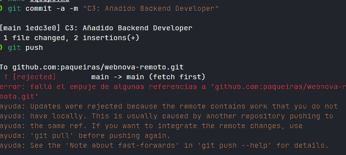
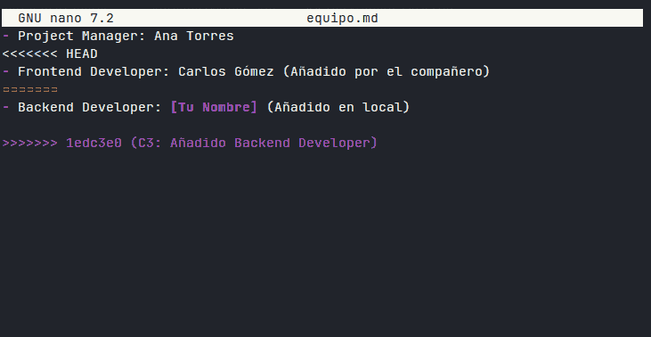

# Práctica 5. Colaboración en GitHub y Resolución de Conflictos Remotos

## Captura 1: Error al hacer git push

## Captura 2: Marcas de conflicto en el editor

## Captura 3: equipo.md finalizado en GitHub

## Pregunta de reflexión

Por que Git bloqueo la subida en la Fase 3?

Git bloqueo el push porque en GitHub habia un commit del compañero que yo no tenia en local. Mi repositorio y el remoto ya no estaban sincronizados y si Git me dejaba subir se perderia el cambio del compañero. Por eso me sale el rejected y me dice que haga primero un git pull.

Que ventaja tiene usar git pull --rebase en lugar de git pull?

Con git pull normal se hace un merge y se crea un commit extra de fusion, asi que el historial queda mas liado. Con git pull --rebase primero se bajan los cambios del remoto y luego se ponen mis commits encima, asi el historial queda en linea recta y mas limpio.
